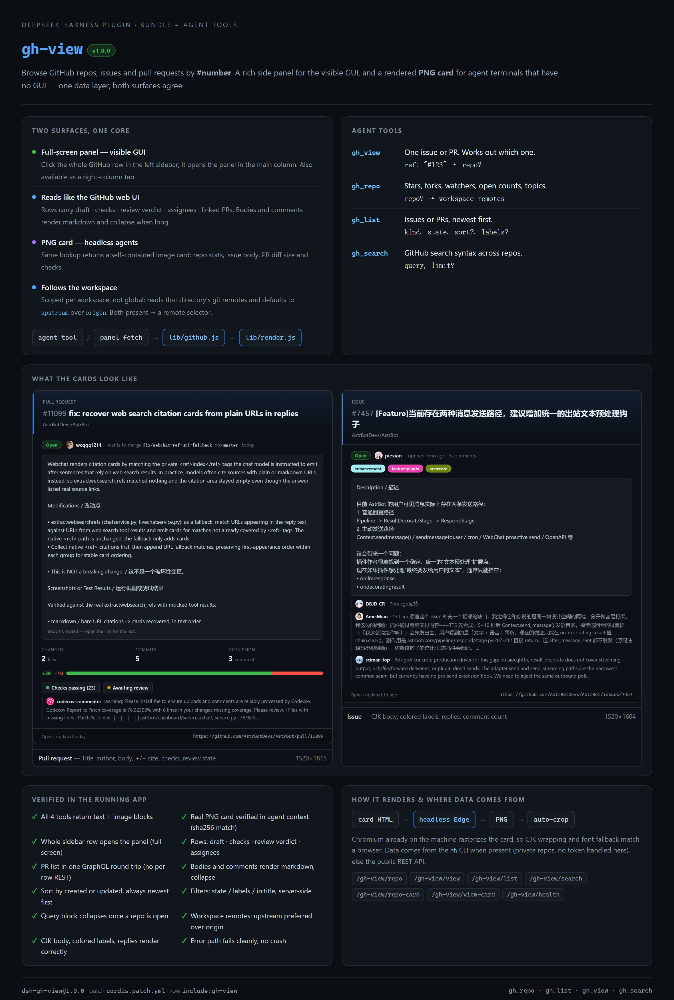

# gh-view

[中文](./README.md) | English

Look up GitHub repos, issues and pull requests by **`#number`** — from a coding agent, a side panel in the DSH window, or a terminal with no GUI that can only show images.



Built for [DeepSeek Harness](https://github.com/deepseek-ai/deepseek-harness) (`dsh`) and any other agent terminal that can read files or call a CLI.

---

## Features

| Surface | What you get |
|---|---|
| **Agent tools** | `gh_repo`, `gh_list`, `gh_view`, `gh_search` — a PNG card and a text summary |
| **Side panel** | A rail on the right edge of the DSH window: type `owner/repo`, then `#123` to open an issue or PR |
| **Image card** | Repos / issues / PRs / lists rendered to PNG for terminals that cannot show HTML |

- List rows show state, check rollup, review verdict, assignees, comment count and linked pull requests.
- Detail pages render issue/PR bodies and comments as markdown: headings, lists, code blocks, quotes, tables, images, `<details>` and GitHub callouts.
- The panel switches workspaces and remotes, filters (state / labels / title), sorts and pages.
- Every surface shares one data layer.

## Install

Requires DeepSeek Harness `^0.2.2-rc.3` (a `0.2.x` release below `0.3.0`) and Node.js 22+.

Install by package name:

- **Plugin Manager**: **Plugins → Add plugin**, target `dsh-gh-view`
- **CLI**: `dsh plugin --profile <profile> add dsh-gh-view`

From a local directory:

```bash
dsh plugin --profile <profile> add /path/to/dsh-gh-view
```

The bundle patch inserts one row:

```yaml
- insert:
    - id: gh-view
      name: dsh-gh-view
      config: {}
```

## Usage

### Agent tools

All four return a card image and a text summary, and accept `image: false`.

#### `gh_view`

```
gh_view(ref: "#123", repo?: "owner/repo", kind?: "any" | "issue" | "pr", image?: true)
```

`ref` accepts `#123`, `123` or `owner/repo#123`; it works out whether the number is an issue or a pull request.

```
gh_view(ref="#11099", repo="AstrBotDevs/AstrBot")
```

#### `gh_repo`

```
gh_repo(repo?: "owner/repo", image?: true)
```

Repository overview: description, stars, forks, watchers, open issue/PR counts, language, license, default branch, topics and latest release.

#### `gh_list`

```
gh_list(repo?: "owner/repo", kind?: "issue" | "pr" | "any",
        state?: "open" | "closed" | "all", labels?, search?,
        sort?: "created" | "updated", limit?, image?: true)
```

`search` keeps rows whose title contains those words; `sort` defaults to `created`.

#### `gh_search`

```
gh_search(query: "repo:owner/name is:open label:bug", limit?, image?: true)
```

#### Default repository

Repository tools take an explicit `repo`. When it is omitted, gh-view detects it from the git remotes of the session's working directory:

- `upstream` wins over `origin`;
- `origin` is used when it is the only remote;
- otherwise the tool says so and asks for `owner/repo`.

The scope is the current directory, never a global setting.

### GitHub panel

Click the **GitHub** row in the left sidebar (under Plugins and Scheduled tasks). It also works as a right-column tab.

- **Close**: **×**
- **Back**: **← Back**, returning to the list you came from with its filters
- **Refresh**: **⟳** (client cache 30 s, server cache 60 s)
- **Query block**: collapses automatically once a repository is detected; ⌄ / ⌃ toggles it
- **Repository**: defaults to the session directory's remotes; a workspace remembers the last choice
- **Paging**: 20 rows per page, **Load more** while the last page is full
- **Filters**: state / labels / title; order: *Newest created* / *Recently updated*
- **Jump**: type `#123` or `owner/repo#123`, press **Jump**

### HTTP routes

| Route | Purpose |
|---|---|
| `GET /gh-view/health` | `{ok, version, build, source, canRender, supportsImageTools, remotes}` |
| `GET /gh-view/remotes?dir=` | GitHub remotes of one directory: `{ok, data: {origin, upstream, preferred, remotes}}` |
| `GET /gh-view/repo?repo=` | repository facts (JSON); `dir=` may replace `repo=` |
| `GET /gh-view/readme?repo=` | repository README as markdown, or `null` |
| `GET /gh-view/repo-card?repo=` | repository card (PNG) |
| `GET /gh-view/view?repo=&ref=` | one issue/PR (JSON) |
| `GET /gh-view/view-card?repo=&ref=` | one issue/PR card (PNG) |
| `GET /gh-view/list?repo=&kind=&state=&labels=&search=&sort=&limit=&offset=&badges=0` | list (JSON), one page |
| `GET /gh-view/search?q=&limit=` | search (JSON) |

Routes that take `repo=` also accept `dir=<workspace path>`.

### Outside DSH

The data and rendering layers are ordinary ES modules with no DSH imports:

```js
import { getRepo, getPull, getAnyRef } from 'dsh-gh-view/lib/github.js'
import { renderCard } from 'dsh-gh-view/lib/render.js'
import { writeFileSync } from 'node:fs'

const pull = await getAnyRef('AstrBotDevs/AstrBot', 11099)
const { png } = await renderCard(pull)
writeFileSync('card.png', png)
```

From a plain checkout, use the relative path (`./lib/github.js`).

## Data sources

- The `gh` CLI when available: it inherits the CLI login, so private repositories work and this plugin never sees a token.
- Otherwise the GitHub REST API, anonymous or with `GITHUB_TOKEN` / `GH_TOKEN`.
- An installed-but-unusable `gh` falls back to REST automatically.
- Anonymous REST is limited to 60 requests/hour; reads are cached for 60 s (remote detection for 10 minutes).

## Image cards

Cards are rasterized by the Microsoft Edge or Google Chrome already installed on the machine, with no extra dependency.

- Without a browser the tools return their text summary and say rendering was skipped.
- Pass `image: false` to turn rendering off.

## Files

| File | Role |
|---|---|
| `index.js` | Host half: tool registration, `/gh-view/*` routes |
| `client.js` | Client half: side panel and tool cards |
| `lib/github.js` | Data layer: `gh` CLI and REST, normalization, caching |
| `lib/render.js` | Card HTML, headless-Chromium rasterizer, PNG cropper |
| `lib/http-guard.js` | Origin/Host checks for the panel routes |
| `cordis.patch.yml` | Bundle patch |
| `locale/{en,zh}.json` | Display metadata |
| `icon.svg` | Bundle icon, exported as `./icon` |
| `gh-view-overview.png` | README overview image |
| `tests/` | Node test runner checks |
| `scripts/overview.mjs` | Builds the overview image (repository only) |
| `assets/` | Screenshots embedded by the overview script (repository only) |
| `.github/workflows/ci.yml` | Tests on Node 22 and 24 |
| `CHANGELOG.md` | Release notes |
| `docs/IMPLEMENTATION.md` | Implementation and security design notes (Chinese) |

## Development

```bash
npm test          # manifest, data layer, docs and packed-file checks
npm run overview  # rebuild gh-view-overview.png (needs Edge or Chrome)
```

`npm test` is what CI runs (Node 22 / 24). The tests are offline and do not include real browser rendering.

## Requirements

- DeepSeek Harness `^0.2.2-rc.3` (declared as `engines.dsh`)
- Node.js 22+ (declared as `engines.node`)
- A profile with `webServer`, `tools`, `attachments` and `workspaceRegistry` (the Web profile ships them)
- The `gh` CLI or network access to `api.github.com`
- Microsoft Edge or Google Chrome, for image cards only

## Security

- Panel HTTP routes check Origin / Host; cross-site requests get 403.
- Routes are served only while DSH is bound to loopback.
- `dir=` is confined to registered workspaces.
- Repository names are strictly validated against argument injection.
- Card bodies are escaped; the panel never injects raw HTML, and links/images pass a scheme allowlist.
- Card rendering is capped at two concurrent browsers.

See [docs/IMPLEMENTATION.md](docs/IMPLEMENTATION.md) for the design details.

## Licence

MIT.
