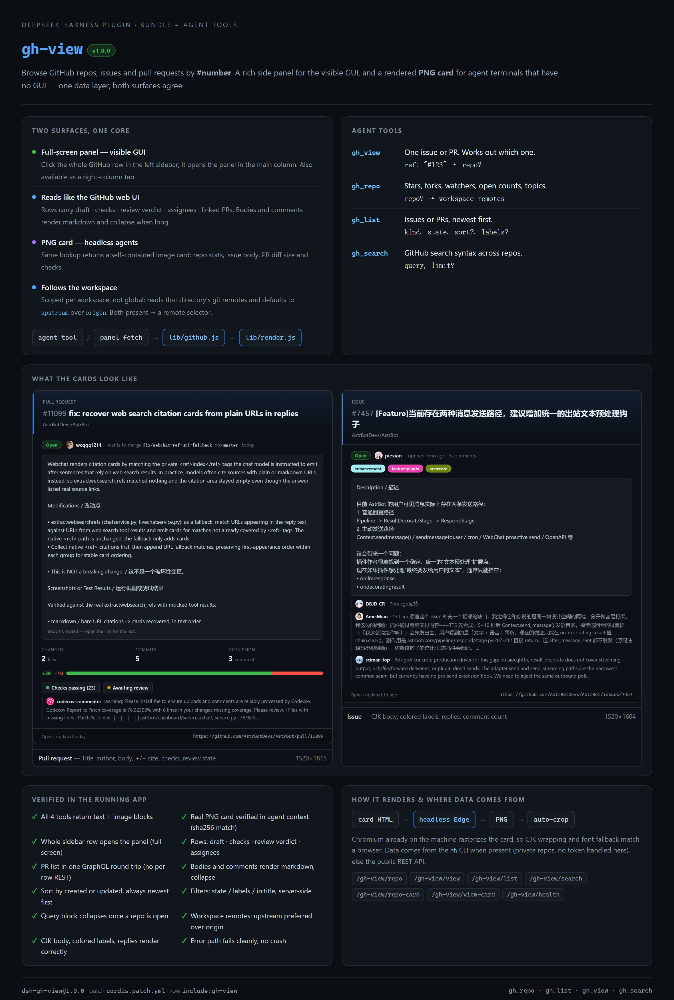

# gh-view

[English](./README.en.md) | 中文

按 **`#number`** 查阅 GitHub 仓库、Issue 和 Pull Request：可作为 DSH 的 agent 工具、窗口侧边面板，也可在无图形界面的终端中输出渲染好的 PNG 卡片。



为 [DeepSeek Harness](https://github.com/deepseek-ai/deepseek-harness)（`dsh`）构建，也适用于任何能读文件或调用 CLI 的 agent 终端。

---

## 功能

| 入口 | 说明 |
|---|---|
| **Agent 工具** | `gh_repo`、`gh_list`、`gh_view`、`gh_search`，返回 PNG 卡片和文字摘要 |
| **侧边面板** | DSH 窗口右侧的面板：输入 `owner/repo`，用 `#123` 打开 Issue 或 PR |
| **图片卡片** | 仓库 / Issue / PR / 列表渲染为 PNG，供不支持 HTML 的终端使用 |

- 列表行显示状态、checks rollup、review 结论、assignees、评论数和关联 PR。
- 详情页渲染 Issue/PR 正文与评论的 markdown：标题、列表、代码块、引用、表格、图片、`<details>`、GitHub callout。
- 面板支持工作区与 remote 切换、筛选（state / labels / title）、排序和分页。
- 所有入口共用同一套数据层。

## 安装

需要 DeepSeek Harness `^0.2.2-rc.3`（`0.2.x` 中低于 `0.3.0` 的版本）和 Node.js 22+。

按包名安装：

- **插件管理器**：**Plugins → Add plugin**，目标 `dsh-gh-view`
- **CLI**：`dsh plugin --profile <profile> add dsh-gh-view`

从本地目录安装：

```bash
dsh plugin --profile <profile> add /path/to/dsh-gh-view
```

bundle patch 会插入一行：

```yaml
- insert:
    - id: gh-view
      name: dsh-gh-view
      config: {}
```

## 使用

### Agent 工具

四个工具都返回卡片图片和文字摘要，均支持 `image: false`。

#### `gh_view`

```
gh_view(ref: "#123", repo?: "owner/repo", kind?: "any" | "issue" | "pr", image?: true)
```

`ref` 支持 `#123`、`123` 或 `owner/repo#123`，自动识别 Issue 或 PR。

```
gh_view(ref="#11099", repo="AstrBotDevs/AstrBot")
```

#### `gh_repo`

```
gh_repo(repo?: "owner/repo", image?: true)
```

仓库概览：描述、stars、forks、watchers、开放 Issue/PR 数、语言、许可证、默认分支、topics、最新 release。

#### `gh_list`

```
gh_list(repo?: "owner/repo", kind?: "issue" | "pr" | "any",
        state?: "open" | "closed" | "all", labels?, search?,
        sort?: "created" | "updated", limit?, image?: true)
```

`search` 按标题过滤；`sort` 默认 `created`。

#### `gh_search`

```
gh_search(query: "repo:owner/name is:open label:bug", limit?, image?: true)
```

#### 默认仓库

仓库类工具可显式传 `repo`；省略时从当前会话工作目录的 git remote 检测：

- `upstream` 优先于 `origin`；
- 只有 `origin` 时使用 `origin`；
- 都没有时报错，并提示传 `owner/repo`。

作用域是当前目录，不是全局设置。

### GitHub 面板

点击左侧边栏（Plugins、Scheduled tasks 之下）的 **GitHub** 行打开，也可作为右侧栏标签页使用。

- **关闭**：**×**
- **返回**：**← Back**，返回来源列表并保留筛选条件
- **刷新**：**⟳**（客户端缓存 30 秒，服务端缓存 60 秒）
- **查询区**：检测到仓库后自动折叠，用 ⌄ / ⌃ 展开
- **仓库选择**：默认取当前会话目录的 remote；切换工作区后记住上次选择
- **分页**：每页 20 行，满页时显示 **Load more**
- **筛选与排序**：state / labels / title；Newest created / Recently updated
- **跳转**：输入 `#123` 或 `owner/repo#123`，按 **Jump**

### HTTP 路由

| 路由 | 用途 |
|---|---|
| `GET /gh-view/health` | `{ok, version, build, source, canRender, supportsImageTools, remotes}` |
| `GET /gh-view/remotes?dir=` | 某个目录的 GitHub remote：`{ok, data: {origin, upstream, preferred, remotes}}` |
| `GET /gh-view/repo?repo=` | 仓库信息（JSON）；`dir=` 可替换 `repo=` |
| `GET /gh-view/readme?repo=` | 仓库 README 的 markdown，或 `null` |
| `GET /gh-view/repo-card?repo=` | 仓库卡片（PNG） |
| `GET /gh-view/view?repo=&ref=` | 单个 Issue/PR（JSON） |
| `GET /gh-view/view-card?repo=&ref=` | 单个 Issue/PR 卡片（PNG） |
| `GET /gh-view/list?repo=&kind=&state=&labels=&search=&sort=&limit=&offset=&badges=0` | 列表（JSON），一页 |
| `GET /gh-view/search?q=&limit=` | 搜索（JSON） |

所有接受 `repo=` 的路由也接受 `dir=<workspace path>`。

### 在 DSH 之外使用

数据层和渲染层是普通 ES 模块，不 import 任何 DSH 内容：

```js
import { getRepo, getPull, getAnyRef } from 'dsh-gh-view/lib/github.js'
import { renderCard } from 'dsh-gh-view/lib/render.js'
import { writeFileSync } from 'node:fs'

const pull = await getAnyRef('AstrBotDevs/AstrBot', 11099)
const { png } = await renderCard(pull)
writeFileSync('card.png', png)
```

从普通 checkout 使用时，把包名换成相对路径（`./lib/github.js`）。

## 数据来源

- 优先使用 `gh` CLI：继承其登录状态，私有仓库可用，本插件不接触 token。
- 没有 `gh` 时使用 GitHub REST API，匿名访问或使用 `GITHUB_TOKEN` / `GH_TOKEN`。
- `gh` 已安装但不可用时，自动回退到 REST。
- 匿名 REST 限制 60 次/小时；读取结果缓存 60 秒，remote 检测缓存 10 分钟。

## 图片卡片

卡片由本机已安装的 Microsoft Edge 或 Google Chrome 无头渲染，无需额外依赖。

- 没有浏览器时返回文字摘要，并说明跳过渲染；
- 传 `image: false` 可完全关闭渲染。

## 文件

| 文件 | 作用 |
|---|---|
| `index.js` | Host 半区：工具注册、`/gh-view/*` 路由 |
| `client.js` | Client 半区：侧边面板与工具卡片 |
| `lib/github.js` | 数据层：`gh` CLI 与 REST、归一化、缓存 |
| `lib/render.js` | 卡片 HTML、无头 Chromium 栅格化、PNG 裁剪 |
| `lib/http-guard.js` | 面板 HTTP 路由的 Origin/Host 校验 |
| `cordis.patch.yml` | bundle patch |
| `locale/{en,zh}.json` | 显示元数据 |
| `icon.svg` | bundle 图标，以 `./icon` 导出 |
| `gh-view-overview.png` | README 总览图 |
| `tests/` | Node test runner 检查 |
| `scripts/overview.mjs` | 生成总览图（仅仓库） |
| `assets/` | 总览图内嵌的截图（仅仓库） |
| `.github/workflows/ci.yml` | Node 22 / 24 测试 |
| `CHANGELOG.md` | 发布说明 |
| `docs/IMPLEMENTATION.md` | 实现与安全设计说明 |

## 开发

```bash
npm test          # manifest、数据层、文档与打包文件检查
npm run overview  # 重新生成 gh-view-overview.png（需要 Edge 或 Chrome）
```

`npm test` 同时用于 CI（Node 22 / 24）。测试离线运行，不包含真实浏览器渲染。

## 环境要求

- DeepSeek Harness `^0.2.2-rc.3`（在 `engines.dsh` 中声明）
- Node.js 22+（在 `engines.node` 中声明）
- 带 `webServer`、`tools`、`attachments` 和 `workspaceRegistry` 的 profile（Web profile 自带）
- `gh` CLI 或可访问 `api.github.com` 的网络
- Microsoft Edge 或 Google Chrome（仅图片卡片需要）

## 安全

- 面板 HTTP 路由校验 Origin / Host，跨站请求返回 403。
- 路由只在 DSH 绑定 loopback 时提供服务。
- `dir=` 参数限于已注册的工作区。
- 仓库名严格校验，阻止参数注入。
- 卡片正文转义；面板不注入原始 HTML，链接和图片走协议白名单。
- 卡片渲染并发上限为 2。

详细设计与实现说明见 [docs/IMPLEMENTATION.md](docs/IMPLEMENTATION.md)。

## 许可证

MIT。
